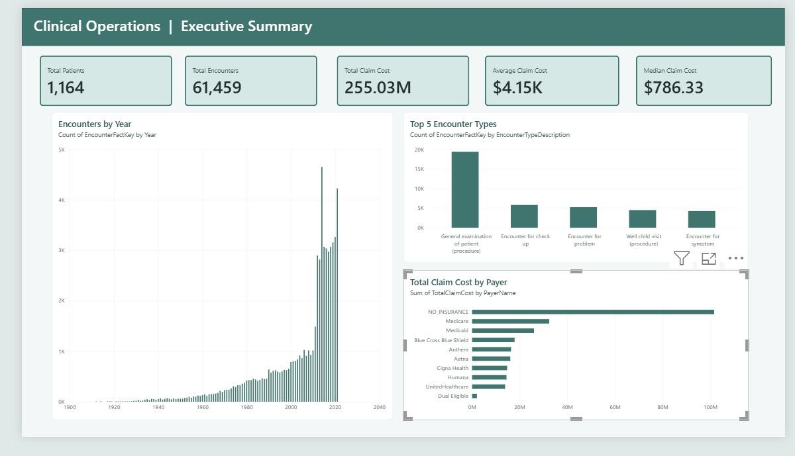

# Healthcare Data Warehouse and Clinical Operations Dashboard

A SLIIT IT3101 Data Warehousing and Business Intelligence group project that turns synthetic healthcare records into a Power BI report for exploring clinical activity and claim costs.

[Dashboard views](#dashboard-views) · [Architecture](#architecture) · [SQL scripts](SQL/) · [Validation](#validation)

## Dashboard views
[Download the Power BI dashboard (.pbix)](ClinicalOperationsDashboard.pbix)

| Encounters | Synthetic patients | Average claim cost per encounter |
| ---: | ---: | ---: |
| 61,459 | 1,164 | Approximately $4.15K |

- [Executive Summary](screenshots/01_Executive_Summary.png) shows key metrics, encounter categories, and claim cost by payer.
- [Trend Analysis](screenshots/02_Trend_Analysis.png) compares encounter volume and claim cost over time.
- [Interactive Analysis](screenshots/03_Interactive_Analysis.png) shows filters and the year-to-quarter-to-month drill-down. The screenshot shows a filtered view.

## Architecture

The warehouse uses a fact constellation with four fact tables for encounters, conditions, procedures, and medications. Nine shared dimensions provide context such as patient, provider, payer, and date. In the assignment, Power BI imported data from the Clinical Operations Data Mart and used DAX for report measures.

## Validation

- Reconciled fact-table row counts against the source data and checked referential integrity.
- Detected a duplicate encounter load when the fact table contained 122,918 rows. The team corrected the load and reconciled the table to the expected 61,459 encounters.
- Compared row counts across 13 warehouse and mart tables and checked Power BI slicers and date drill-downs.

## Repository contents

| Path | Contents |
| --- | --- |
| [SQL/](SQL/) | Original SQL Server scripts for database creation, dimension and fact tables, and schema validation |
| [screenshots/](screenshots/) | Three views of the Power BI report |

To review the schema in a local SQL Server sandbox, run scripts `01` through `07` in numeric order using SQL Server Management Studio. Script `01` creates `Synthea_Staging` and `Synthea_DW`. These scripts create and check the schema. Reproducing the populated dashboards also requires the source data, the SSIS loads, the data mart, and the Power BI report.

**Technology:** SQL Server, SQL Server Integration Services (SSIS), Power BI, DAX

**Data source:** [Synthea synthetic patient data](https://github.com/synthetichealth/synthea)
